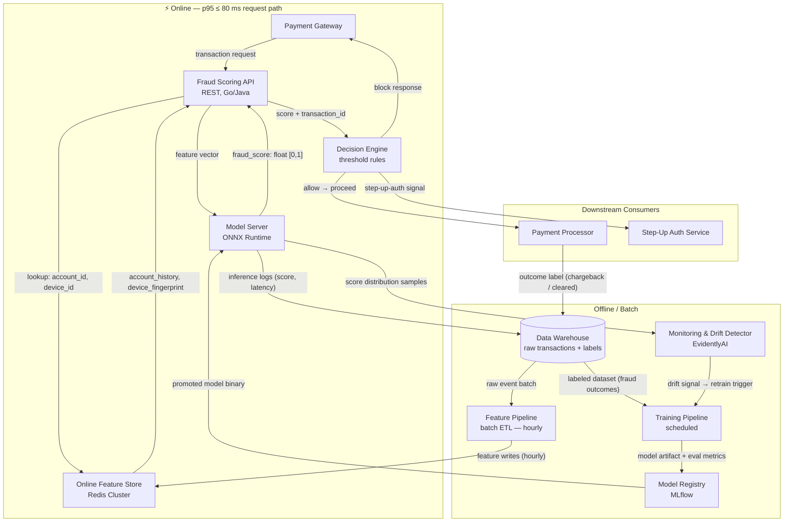

# Architecture — Scenario A: Real-Time Fraud Scoring

**Serving pattern:** Online synchronous inference, p95 ≤ 80 ms end-to-end.

## Serving Boundary

| Layer | What runs there |
|---|---|
| **Online** | Fraud Scoring API, Online Feature Store (Redis), Model Server (ONNX), Decision Engine |
| **Batch / Offline** | Feature ETL pipeline, Training pipeline, Model Registry, Monitoring |

## Feedback Loop

1. Payment Processor writes chargeback/cleared **outcome labels** back to the Data Warehouse.
2. Model Server streams **score distribution samples** to the Drift Detector.
3. Monitoring detects feature drift (PSI > 0.2) or label drift → emits **retrain trigger** to Training Pipeline.
4. Training Pipeline reads fresh labeled dataset from DW, trains, pushes artifact to Registry.
5. Registry promotes model → Model Server hot-reloads the binary without restart.
