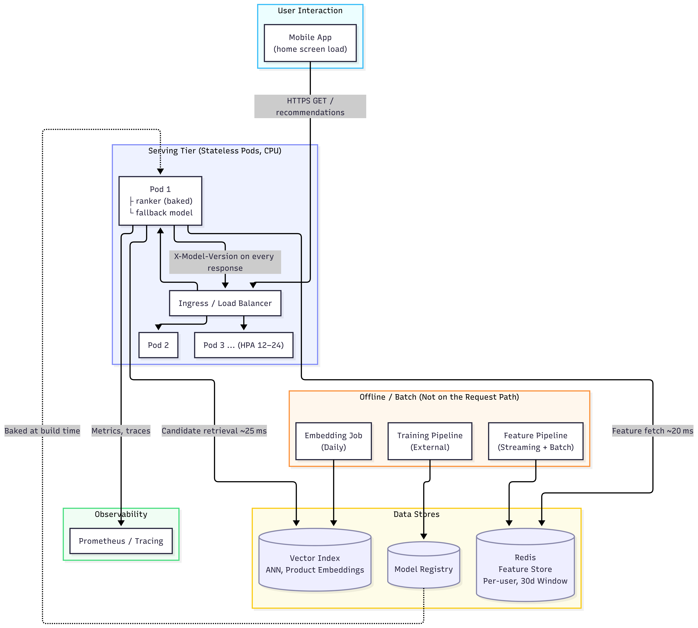

# Architecture

Scenario X — personalized in-app recommendations for a B2C retail mobile app.

The design goal that shapes everything below: respond in **under 120 ms p95** at **~800 RPS peak**,
while keeping the model version traceable for continuous A/B testing.

## Diagram

> If Mermaid doesn't render in your viewer, the same structure in words: app → load balancer →
> a pool of stateless CPU pods. Each pod talks to Redis (features) and a vector index (candidates),
> runs the ranker locally, and emits the model version + metrics. Everything that *produces* data
> (feature pipeline, embedding job, training) lives off the request path.

## Components

**Ingress / load balancer.** TLS termination and round-robin across pods. Health-checked against the
`/healthz` (liveness) and `/readyz` (readiness) endpoints — a pod that can't load its baked model or
reach Redis fails readiness and gets pulled out of rotation instead of serving errors.

**Serving pods (the core).** Stateless, horizontally scaled, CPU-only. Each pod ships with the
`ranker` model *inside the image* (see [ADR-0001](adr/0001-bake-model-into-image.md)) plus the
cold-start fallback model. Statelessness is what makes the HPA and the rollback story simple — any
pod can serve any request, and rolling back is just deploying the previous image tag.

**Redis feature store.** Holds the per-user features derived from the last 30 days of browsing and
purchases. Read on the hot path, written by the offline feature pipeline. We read it, we never write
it from the serving tier — that keeps the request path side-effect-free.

**Vector index (ANN).** Approximate-nearest-neighbour over product embeddings, used to cut the catalog
down to a few hundred candidates *before* the ranker scores them. Ranking the whole catalog per
request would blow the latency budget; retrieve-then-rank is what keeps us under 120 ms.

**Offline tier.** The feature pipeline, the daily embedding job, and the (external) training pipeline.
None of it is on the request path. The training pipeline publishes to the model registry; the registry
artifact is what gets baked into the image at build time — it does not get pulled at runtime.

**Observability.** Every pod exposes Prometheus metrics and emits traces. The `X-Model-Version`
response header is the thread that ties a served request back to the exact model the user saw, which
is what makes the A/B attribution and the version-mismatch alert possible.

## Request path & latency budget

This is the same budget the [capacity plan](../serving/capacity-plan.md) and
[slos.yaml](../serving/slos.yaml) are built on — they must agree, and they do.

| Stage | Budget (p95) | Notes |
|---|---|---|
| Ingress + network in | 15 ms | TLS, routing |
| Feature fetch (Redis) | 20 ms | single round trip, pipelined keys |
| Candidate retrieval (ANN) | 25 ms | top ~300 candidates |
| Ranking inference (CPU) | 40 ms | the ranker scoring candidates |
| Serialize + network out | 20 ms | response assembly |
| **Total** | **120 ms** | matches the SLO objective |

The 40 ms inference number is the one I'd most want to validate on real hardware — it's the basis of
the replica math, so the [load test plan](../serving/load-test-plan.md) is designed to confirm it.

## Cold start

If a user has no history (the feature fetch comes back empty), the pod scores with the **fallback
model** — popularity within the user's coarse segment (region, platform, maybe acquisition channel).
Same code path, same latency budget, just a different model object. The response still carries an
`X-Model-Version` (e.g. `fallback-2.1`) so A/B analysis can separate cold-start traffic cleanly.

See [JUSTIFICATION.md](JUSTIFICATION.md) for *why* this shape and not the alternatives, and the
[ADRs](adr/) for the two decisions I'd defend hardest.
