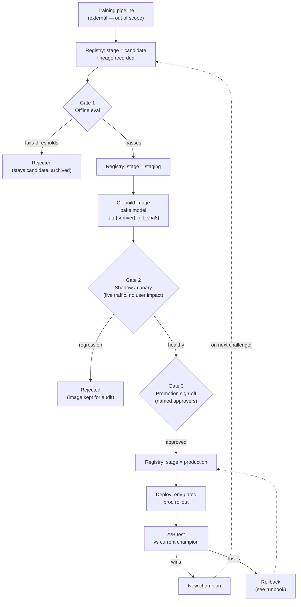

# Model lifecycle

How a `ranker` model goes from "someone trained a candidate" to "serving 800 RPS in production," and
how it comes back out again. Gates and approvers are named on purpose — a generic "it gets reviewed"
isn't enough to act on.

## End-to-end diagram

## Stages (these are the `stage` values in [model-registry.yaml](model-registry.yaml))

| Stage | Meaning | How a model leaves it |
|---|---|---|
| `candidate` | Just registered from training. Not eval'd yet. | Passes Gate 1 → `staging`; else archived. |
| `staging` | Passed offline eval, image built, in shadow/canary. | Passes Gate 2 + Gate 3 → `production`. |
| `production` | The champion (or an active A/B challenger) serving live. | Replaced by a new champion, or rolled back. |
| `archived` | Retired or rejected. Kept for audit, never deleted. | Terminal. |

## Gates

**Gate 1 — Offline evaluation (automated).**
- *What:* the candidate is scored on a held-out evaluation set. Ranking quality (NDCG@10, recall@100)
  must be **≥ current champion − 1%** (no meaningful regression), and the artifact must pass a schema/
  shape check so it'll actually load in the serving code.
- *Owner:* automated in CI; results attached to the registry entry. No human needed to *reject*; a
  human can override to proceed (recorded).
- *Blocks on:* missing lineage fields, eval below threshold, artifact fails to load.

**Gate 2 — Shadow / canary (automated + observed).**
- *What:* the new image runs against **live traffic in shadow** (scores real requests, results not
  shown to users) and then a small **canary** (1–5% real traffic). We watch p95 latency, error rate,
  and prediction-distribution drift against the champion.
- *Owner:* automated health checks + the on-call serving engineer eyeballing the canary dashboard.
- *Blocks on:* p95 over budget, error rate up, prediction drift beyond the alert threshold.

**Gate 3 — Promotion sign-off (human, named).**
- *What:* explicit approval to promote `staging` → `production`.
- *Approvers (need both):*
  - **ML lead** — confirms the offline + canary numbers justify promotion.
  - **Serving on-call lead** — confirms operational readiness (capacity, no conflicting deploy freeze).
- *Recorded:* approver identities + timestamp written to the registry entry's `promotion` block. This
  is the audit trail. The CI production job will not run without both approvals present.

## A/B test (post-deploy)

Promotion to production doesn't crown a champion — it puts a **challenger** into an A/B test against the
current champion. The `X-Model-Version` header on every response is what attributes each impression to
the right arm. The product team calls the winner on their business metric; only then does the registry
`champion` pointer move. A losing challenger is rolled back per the runbook and archived.

## Lineage / provenance (recorded for every model)

Every registry entry carries enough to answer "where did this model come from?" months later — exact
fields are in [model-registry.yaml](model-registry.yaml): training run ID, dataset snapshot/version,
feature-set version, code commit, base image, trained-by, and the eval results that got it through
Gate 1. For a continuously A/B-tested, audited system this lineage is the difference between "we think"
and "we know."

## Coherence notes

- The image tag written at the build step (`{semver}-{git_sha8}`) is exactly what the
  [CI pipeline](../cicd/.github/workflows/deploy-model.yml) produces and what the registry stores.
- Gate 2's drift/latency checks use the same thresholds the [alerts](../monitoring/alerts.yaml) fire
  on in production — we don't promote into conditions we'd page on.
- Rollback here points at the same [runbook](../runbooks/rollback.md) used in the incident path.
